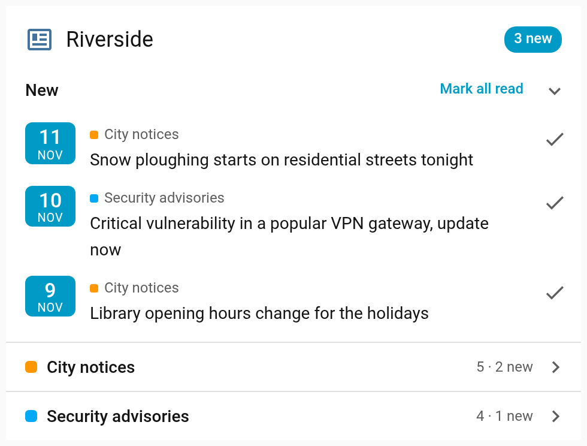
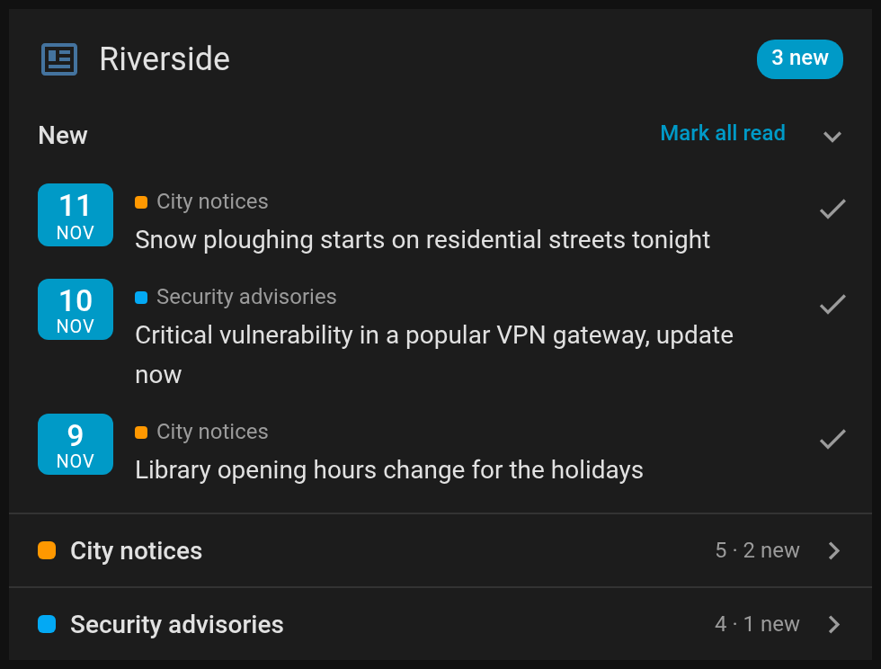
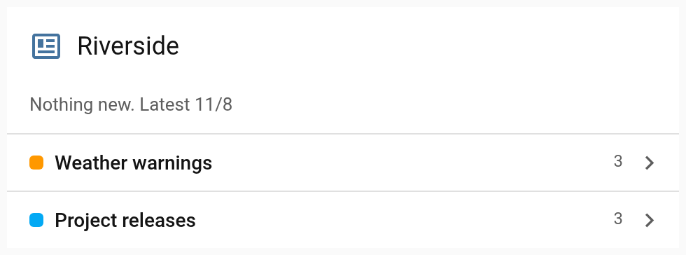
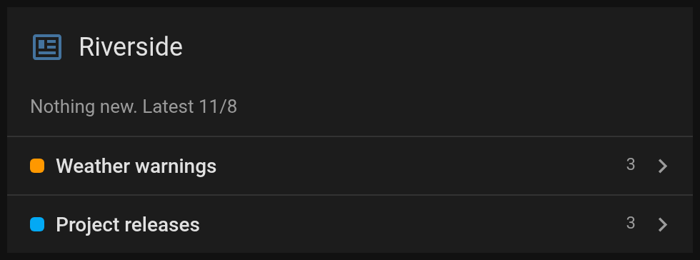
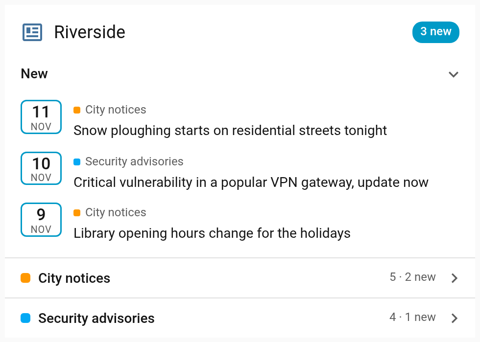
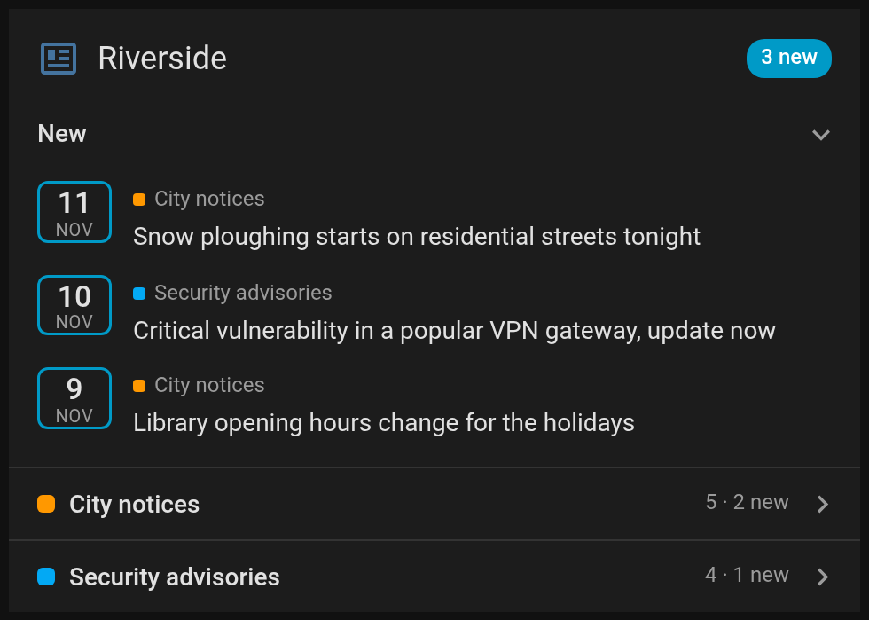

# Feeds card

Home Assistant dashboard card for RSS and Atom feeds, each a list of its own, with the items you haven't seen gathered
above them.

[![GitHub Release][releases-shield]][releases] [![GitHub Release Date][release-date-shield]][releases] [![Downloads][downloads-shield]][releases] [![Marketplace][marketplace-shield]][marketplace] [![License][license-shield]](LICENSE)

<p>




</p>

## What is it?

A custom card for news, notices and advisories that come as RSS or Atom feeds. Each feed is a list of its own that
folds away, so a feed that posts twice a year isn't buried under one that posts every day. The items you haven't seen
yet, from every feed, are gathered into one list at the top, newest first. Most of the time that list is empty, and the
card is a title and a line per feed.

What you have seen is kept in Home Assistant for each user, not in the browser, so an item read on the desktop isn't new
again on the phone. An item is seen once it has been on screen for a moment, or once you mark it read, as you choose.
Opening an item's link marks it seen either way. The card sends no notifications.

It reads a feed sensor's `entries` attribute, the format the [Feed entries](https://github.com/jesmak/feed_entries)
integration and the [feedparser](https://github.com/custom-components/feedparser) integration write ([Data](#data)).

## Installation

### With the Marketplace

1. Open Settings › Marketplace, choose Add from link and paste `https://github.com/jesmak/feeds-card`
2. Open Feeds card in the Marketplace and choose Install
3. Refresh your browser

### Manual

1. Take `dist/feeds-card.js` from the source code of the [latest release][releases] and copy it to the `config/www`
   folder of your Home Assistant installation
2. In Home Assistant settings, open dashboards, click the three dots at the top right and open resources
3. Add a new resource with the path `/local/feeds-card.js` and type JavaScript
4. Refresh your browser

The card needs feed sensors to show. [Feed entries](https://github.com/jesmak/feed_entries) makes one per feed from its
setup form.

## Options

| Name          | Type   | Description                                                                                                                                                                                                                                                                    | Default                                                                         |
| ------------- | ------ | ------------------------------------------------------------------------------------------------------------------------------------------------------------------------------------------------------------------------------------------------------------------------------ | ------------------------------------------------------------------------------- |
| `type`        | string | `custom:feeds-card`                                                                                                                                                                                                                                                            | required                                                                        |
| `entities`    | list   | The feed sensors, each a list of its own. An entity id, or an object with `entity`, `name` to replace the sensor's name and `color` for the feed, any CSS colour                                                                                                               | required                                                                        |
| `title`       | string | Shown at the top of the card, with the number of new items beside it                                                                                                                                                                                                           | Feeds, translated                                                               |
| `icon`        | string | An icon before the title                                                                                                                                                                                                                                                       |                                                                                 |
| `mark`        | string | What makes an item seen. `auto` once it has been on screen for a moment, `manual` with a button on each item and one for them all                                                                                                                                              | `auto`                                                                          |
| `items`       | number | How many items a feed's list shows. The rest are behind Show all                                                                                                                                                                                                               | `5`                                                                             |
| `attribute`   | string | The sensor attribute that holds the entries                                                                                                                                                                                                                                    | `entries`                                                                       |
| `height_mode` | string | How tall the card is. `auto` fits its content, `fixed` keeps it at `height`, `max` lets it grow up to `max_height`. In `fixed` and `max` the open list scrolls. A height in grid rows, set in the layout tab of a sections view, is used instead                               | `fixed` when `height` is set, `max` when only `max_height` is, otherwise `auto` |
| `height`      | number | The card's height in pixels, for `fixed`                                                                                                                                                                                                                                       |                                                                                 |
| `max_height`  | number | The card's greatest height in pixels, for `max`                                                                                                                                                                                                                                |                                                                                 |
| `row_step`    | string | How the card rounds its height on automatic rows in a sections view, with `height_mode` at `auto` or `max`. `full` ends it on whole rows, `half` on half rows, which saves up to half a row but can leave the cards under it half a row off the rows of the sections beside it | `full`                                                                          |

Every option is in the visual editor, except `height_mode`, `height` and `max_height`, which are set in YAML. In a
sections view the layout tab sets the card's height. They are for where there is no layout tab, such as a masonry or
panel view, or a stack or other card the card is inside, even in a sections view. A feed without a colour of its own
gets one from the theme's palette, in the order the feeds are given.

## What it shows

Under the title come the new items, then a line for each feed with its colour, its name and how many items it has, and
how many of them are new. One of these is open at a time, and opening another folds it. While there are new items,
their list is open. Each item has its date as a badge, the day large and the month under it, with the year only when
it isn't this year's, and its title as a link. A new item also names its feed, as the list mixes them.

A feed's list shows its items newest first, up to `items`, and a button shows the rest. Items in the new list aren't
repeated in their feed's.

When nothing is new, the list shrinks to one line with the date of the latest item of all.

### Marking items seen

With `mark: auto`, an item is seen once most of it has been on screen for a second and a half, while the page is in
view. Its badge turns into an outline, and the item stays where it is until the card is next loaded, such as when you
come back to the view, so the list doesn't move under you while you read. An item scrolled away inside the card or in
a folded list isn't on screen.




With `mark: manual`, each new item has a button that marks it read, and Mark all read marks them all. A marked item
moves to its feed at once.

The first time you load a feed, everything already in it counts as seen, so the new list starts empty rather than
holding the whole feed. Each Home Assistant user has their own seen items, kept per feed sensor, so two cards showing
the same feed agree.

### Sizes

In a sections view the card takes 12 columns by default and at least 9, and grows as tall as its open list. On
automatic rows it ends on whole rows, and any room left over goes under the title. With `row_step: half` it ends on
half rows instead.

Held to a height, by rows set in the layout tab or by `height` or `max_height`, the title and the lines stay where they
are and the open list scrolls in what is left. The card never gets lower than the title, every line and the first item
of the open list need at the width its columns allow. Titles wrap, so a long one makes the list scroll further.

## Examples

### Two feeds

```yaml
type: custom:feeds-card
title: Riverside
icon: mdi:newspaper-variant-outline
entities:
  - entity: sensor.city_notices
    name: City notices
  - entity: sensor.security_advisories
    name: Security advisories
    color: "#d08770"
```

### Marked read by hand, with longer lists

```yaml
type: custom:feeds-card
mark: manual
items: 10
entities:
  - sensor.project_releases
```

## Data

The card reads a list of entries from an attribute of each sensor, `entries` unless `attribute` says otherwise, in the
shape the Feed entries and feedparser integrations write. Each entry is an object, of which the card reads these
fields.

| Field       | What the card does with it                                                                                           |
| ----------- | -------------------------------------------------------------------------------------------------------------------- |
| `title`     | The item's title. An entry without one is titled by its link                                                         |
| `link`      | Where the title leads. An entry with neither a title nor a link is left out                                          |
| `id`        | What the item is remembered by. Without it the link, and without that the title                                      |
| `published` | The item's date, or `updated` when there is none. ISO 8601, RFC 822 as in RSS, or seconds or milliseconds since 1970 |

A date without a four-digit year is left out, as a browser would make up a year of its own for it. feedparser's
default `date_format` has none, so with feedparser set `date_format: "%Y-%m-%dT%H:%M:%S%z"` for each feed. Feed entries
writes its dates as ISO 8601. A feed whose entries all have dates is shown newest first, and one with an entry without
a date in its own order.

What each user has seen is kept in Home Assistant's own store for the user, one key per feed sensor, named
`feeds-card.<entity id>`. The card fetches nothing itself.

## Translating

The card's texts are in `src/localize/languages/`, one JSON file per language, named by its language code, such as
`en.json` and `fi.json`. To add a language, copy `en.json` to the new language's code, such as `sv.json`, and
translate the values. Nothing else needs changing. The card finds the file by itself and uses it when Home Assistant
is set to that language. A text left out falls back to English. The feeds' own titles are shown as they are.

## Development

Requires Node 22.13 or newer.

```
npm install
npm run check
```

`npm run check` typechecks, lints, checks formatting, runs the tests and builds `dist/feeds-card.js`, which is the file
the Marketplace installs and is committed to the repository.

| Path                       | What it contains                                                              |
| -------------------------- | ----------------------------------------------------------------------------- |
| `src/feeds-card.ts`        | The card itself                                                               |
| `src/editor.ts`            | The visual editor                                                             |
| `src/feeds.ts`             | Reading a feed sensor's entries and their dates                               |
| `src/seen.ts`              | Keeping what each user has seen in Home Assistant                             |
| `src/types.ts`             | The card's options and the shapes of what it shows                            |
| `src/const.ts`             | Defaults, timings and the feeds' colours                                      |
| `src/hass.ts`              | The few Home Assistant types the card needs                                   |
| `src/height.ts`            | The height mode, shared with the author's other cards                         |
| `src/rows.ts`              | Rounding to the rows of a sections view, shared with the author's other cards |
| `src/fade.ts`              | The fading edges of what scrolls, shared with the author's other cards        |
| `src/localize/localize.ts` | Finding the viewer's language and its texts                                   |
| `scripts/build.mjs`        | The esbuild build                                                             |
| `src/localize/languages/`  | The card's texts, one JSON file per language                                  |
| `docs/screenshots.json`    | The made-up data the README's screenshots are taken from                      |
| `tests/`                   | Tests, run with vitest                                                        |

## Support

Hey dude! Help me out for a couple of :beers: or a :coffee:!

[](https://www.buymeacoffee.com/jesmak)

## License

MIT, see [LICENSE](LICENSE).

[releases-shield]: https://img.shields.io/github/release/jesmak/feeds-card.svg?style=for-the-badge
[release-date-shield]: https://img.shields.io/github/release-date/jesmak/feeds-card?style=for-the-badge
[releases]: https://github.com/jesmak/feeds-card/releases
[downloads-shield]: https://img.shields.io/github/downloads/jesmak/feeds-card/total.svg?style=for-the-badge
[marketplace-shield]: https://img.shields.io/badge/Marketplace-Custom-orange.svg?style=for-the-badge
[marketplace]: https://my.home-assistant.io/redirect/marketplace_repository/?owner=jesmak&repository=feeds-card&category=plugin
[license-shield]: https://img.shields.io/github/license/jesmak/feeds-card.svg?style=for-the-badge
